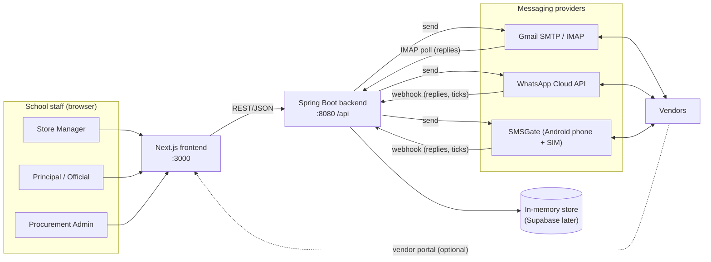
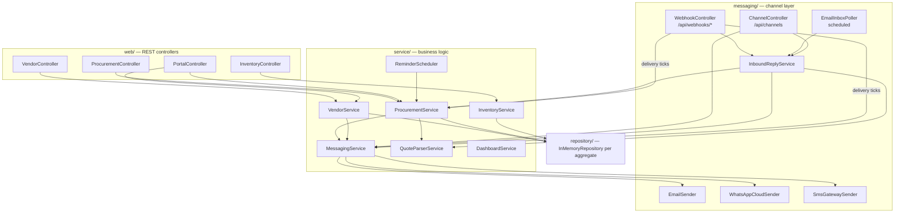
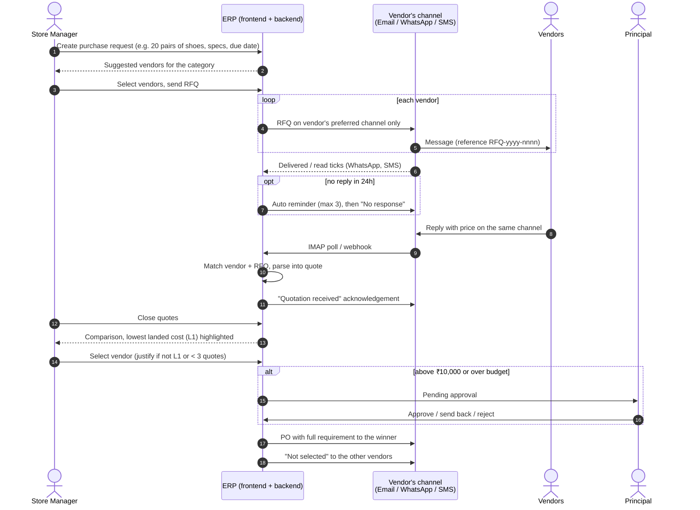
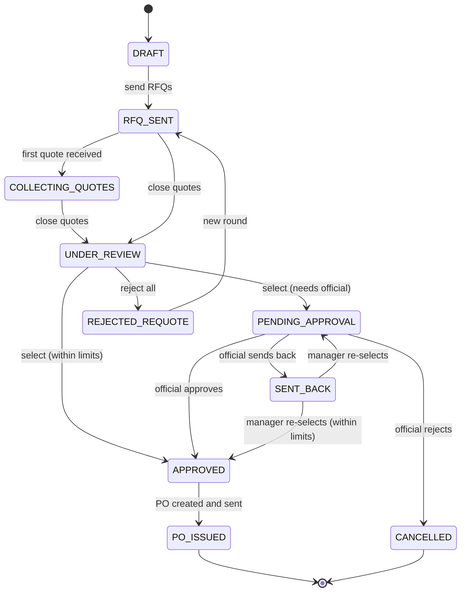
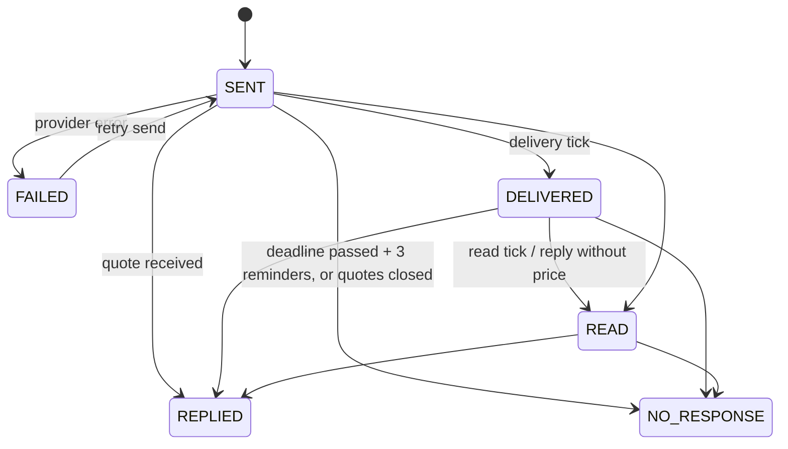
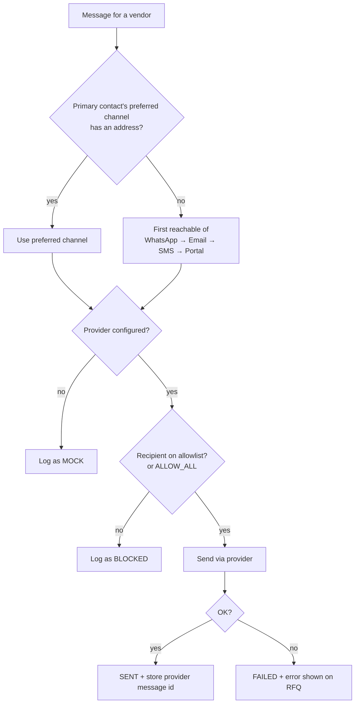
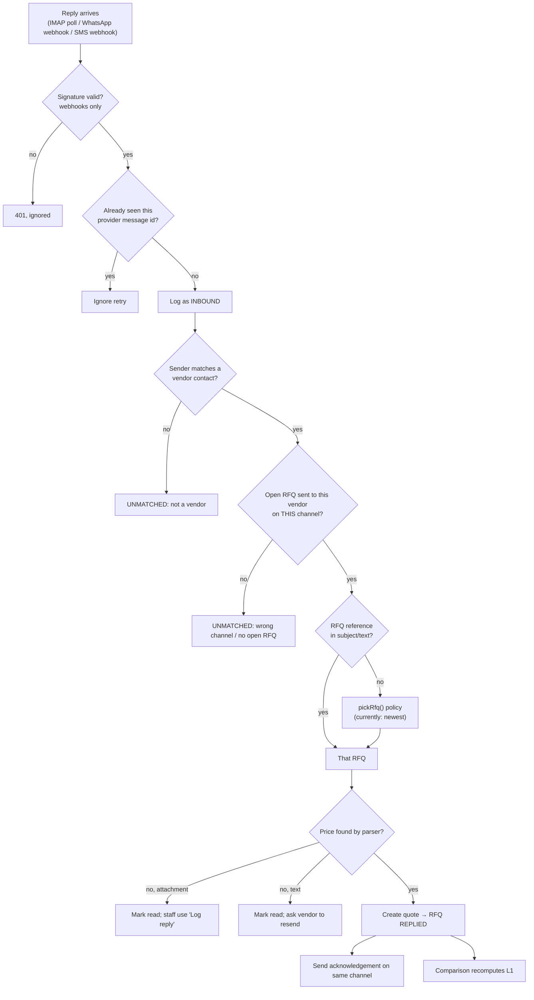
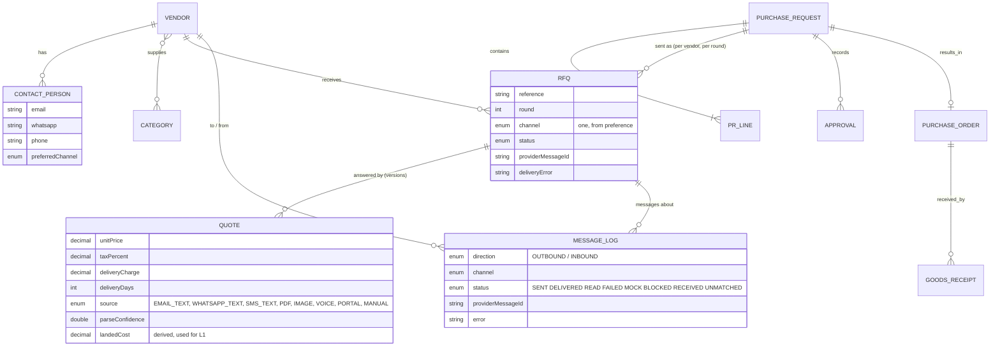

# Architecture and project flow

Greenfield School ERP, Inventory module: vendor management, procurement (PR → RFQ → quotes → approval → PO),
goods receipt and stock. This document covers how the pieces fit together and how a purchase moves through
the system, with the vendor messaging layer (Email / WhatsApp / SMS) in detail.

Status: architecture and flow are built and tested in **mock mode**. Connecting real providers (Gmail, WhatsApp
Cloud API, SMSGate) and moving storage to Supabase are the next steps; see [Configuration](#7-configuration-next-step).

---

## 1. System context

The school talks to each vendor on **one channel: the vendor's preferred one**. The vendor replies on that same
channel, and the backend turns the reply into a quote. Vendors never need to log in, though portal-enabled vendors can.

---

## 2. Components

### Backend (`backend/src/main/java/com/schoolerp/inventory/`)

| Layer | Responsibility |
|---|---|
| `web/` | HTTP in/out, validation, error mapping. No business rules. |
| `service/ProcurementService` | The procurement state machine: RFQ rounds, quotes, comparison (L1), review, approval, PO. |
| `service/MessagingService` | Picks the vendor's channel, builds message text, calls the right sender, keeps the two-way message log, enforces the test allowlist. |
| `messaging/*Sender` | One class per provider behind the `ChannelSender` interface. Mock when not configured. |
| `messaging/InboundReplyService` | Reply → vendor → RFQ → parsed quote → acknowledgement. |
| `messaging/WebhookController`, `EmailInboxPoller` | Transport for inbound replies and delivery/read receipts. Verify provider signatures. |
| `service/QuoteParserService` | Free text → price, GST, delivery charge/days, validity, terms, plus a confidence score. |
| `repository/` | In-memory now; same method shapes as Spring Data so it can be swapped for Supabase/Postgres. |

### Frontend (`frontend/src/`)

| Route | Used by | Purpose |
|---|---|---|
| `/procurement`, `/procurement/[id]` | Store Manager | Create request, pick vendors, track RFQs, compare quotes, review |
| `/approvals` | Principal | Second-level approval |
| `/vendors`, `/vendors/compliance` | Procurement Admin | Onboarding, documents, preferred channel per contact |
| `/outbox` (Messages) | All | Two-way message log, channel status, test send, simulate reply |
| `/purchase-orders`, `/inventory/*` | Store | POs, goods receipt, stock |
| `/portal/[vendorId]` | Vendor | Optional sealed-bid quote form and PO acknowledgement |

---

## 3. End-to-end procurement flow

### Purchase request states

### RFQ (per vendor) states

---

## 4. Messaging layer

### 4.1 Outbound: which channel?

The chosen channel is saved on the RFQ. Reminders, the acknowledgement, the PO and the "not selected" note all
reuse **that same channel**, so a vendor only ever hears from the school in one place.

Message formats per channel:

| | RFQ | PO (award) |
|---|---|---|
| Email | Full RFQ: items, specs, qty, delivery date and place, reply-by, what to include | Full PO: item, specs, qty, rate, GST, delivery charge, total, deliver by/to, payment terms |
| WhatsApp | Approved template to open the chat (Meta rule), then free text | Full PO text |
| SMS | Short single-line RFQ (each 160 chars is billed) | Short PO line, "reply YES to confirm" |

### 4.2 Inbound: reply → quote

### 4.3 Delivery receipts

WhatsApp (`statuses`: delivered / read / failed) and SMSGate (`sms:delivered` / `sms:failed`) send receipts with
the provider message id. `MessagingService.updateStatus` updates the log (never moves backwards: read stays
read), and `ProcurementService.applyDeliveryReceipt` moves the RFQ along `SENT → DELIVERED → READ`.

### 4.4 Endpoints

| Endpoint | Caller | Purpose |
|---|---|---|
| `GET /api/channels` | Frontend | Live/mock per channel, allowlist |
| `POST /api/channels/test` | Frontend | Send a test message to a typed recipient |
| `POST /api/channels/simulate-inbound` | Frontend | Feed a reply as if from a provider (testing) |
| `GET /api/webhooks/whatsapp` | Meta | One-time verify handshake |
| `POST /api/webhooks/whatsapp` | Meta | Replies + status ticks, `X-Hub-Signature-256` checked |
| `POST /api/webhooks/sms` | SMSGate | `sms:received/delivered/failed`, `X-Signature` + `X-Timestamp` checked (±5 min) |
| `GET /api/outbox` | Frontend | Message log (both directions) |

---

## 5. Data model (core)

**L1** = lowest landed cost = `unitPrice × qty + GST + delivery charge`, over the latest quote version per vendor
in the current round.

---

## 6. Business rules enforced in the backend

- Only `ACTIVE` vendors get RFQs; a vendor with no reachable address is refused at send time.
- One channel per RFQ; replies count only on that channel.
- Fewer than 3 quotes, or choosing a non-L1 quote, needs a written justification.
- Low-confidence parsed quotes must be verified by the manager before they can be selected.
- Above ₹10,000 or over budget → official (second-level) approval.
- Auto-reminder sweep every 10 min: 24 h interval, max 3, then No Response after the deadline.
- Live sends only to the allowlist until `MESSAGING_ALLOW_ALL=true`.

---

## 7. Configuration (next step)

All provider settings are read from environment variables or the git-ignored `backend/.env`
(template: `backend/.env.example`). Any channel left blank runs in mock mode, so the whole flow works without credentials.

| Order | Step | Needs |
|---|---|---|
| 1 | Email live | Gmail address, App Password, `MESSAGING_ALLOWED_RECIPIENTS` |
| 2 | WhatsApp live | Meta app, phone number id, token, approved `rfq_request` template, public URL (ngrok) for the webhook |
| 3 | SMS live | Android phone with SMSGate, send URL + credentials, webhook registration, signing key |
| 4 | Persistence | Supabase Postgres tables mirroring `model/` (incl. `messages`), JPA repositories |
| 5 | Auth | Supabase Auth replaces the "Acting as" switcher and portal mock sign-in |
| 6 | Hosting | Backend on a public HTTPS host so webhooks no longer need ngrok |

Open design decision: `InboundReplyService.pickRfq()`, which RFQ an unreferenced reply belongs to when a vendor
has several open RFQs on the same channel (currently: the newest).
